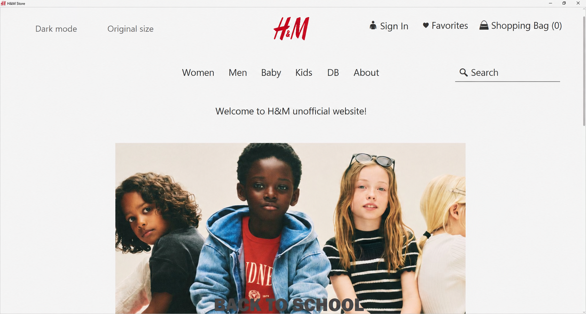
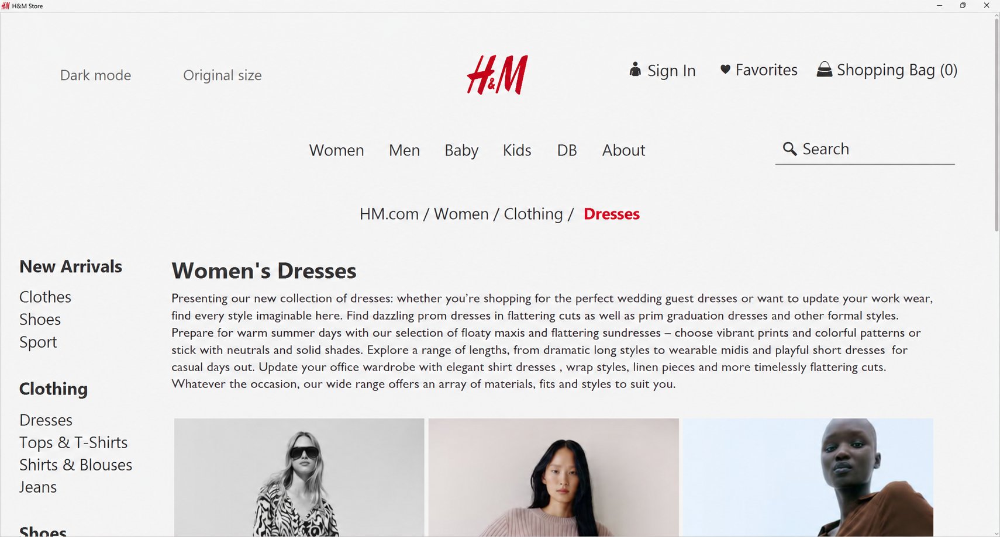
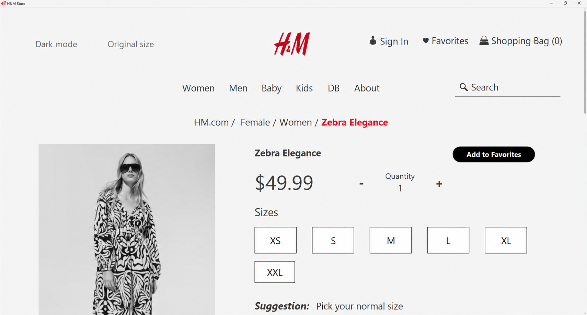

# H&M Store

A JavaFX clothing storefront backed by a local PostgreSQL database. The application reads its catalog and account data from the configured database and writes shopping activity there.

## Screenshots

The images below are high-resolution captures of the running application.

### Storefront

<p align="center">
  
</p>

### Women's clothing catalog

<p align="center">
  
</p>

### Product details

<p align="center">
  
</p>

## Features

- Browse clothing categories and search the catalog.
- View product details, prices, images, and available sizes.
- Use favorites and the shopping bag.
- Sign in or create an account.
- Browse the connected database from the app's **DB** section.
- Switch between light and dark themes and restore the original display size.
- Use custom in-app alerts for information, errors, and confirmations.

## Requirements

- JDK 25
- Maven 3.9 or later
- PostgreSQL

## Run with your local PostgreSQL database

H&M Store uses the PostgreSQL database configured for your local installation. The repository does not load sample catalog or account records; the app displays the records in the database you connect.

1. Create a PostgreSQL database for the project if you do not already have one:

   ```powershell
   psql -U postgres -d postgres -c 'CREATE DATABASE "hm-db";'
   ```

2. Apply the project schema and required database scripts from the repository root:

   ```powershell
   psql -U postgres -d hm-db -v ON_ERROR_STOP=1 -f database/postgresql/schema.sql
   psql -U postgres -d hm-db -v ON_ERROR_STOP=1 -f database/postgresql/sync-identities.sql
   psql -U postgres -d hm-db -v ON_ERROR_STOP=1 -f database/postgresql/migrations/001_order_details.sql
   ```

3. Create a local environment file from the template and enter the connection details for your PostgreSQL instance:

   ```powershell
   Copy-Item .env.example .env
   notepad .env
   ```

   Set the host, port, database name, username, and password. For a local default PostgreSQL installation, the host is usually `localhost` and the port is usually `5432`. `.env` is ignored by Git and must remain local.

4. Start the application:

   ```powershell
   mvn javafx:run
   ```

If you already have a database configured, set `.env` to that database and start the app. H&M Store will use its existing records.

## Build and tests

```powershell
mvn -B -ntp test
mvn -B -ntp package
```

## License

The project code is distributed under the [MIT License](LICENSE). Third-party names and logos displayed by the application belong to their respective owners; this project is not affiliated with them.

For security concerns, see [SECURITY.md](SECURITY.md).
