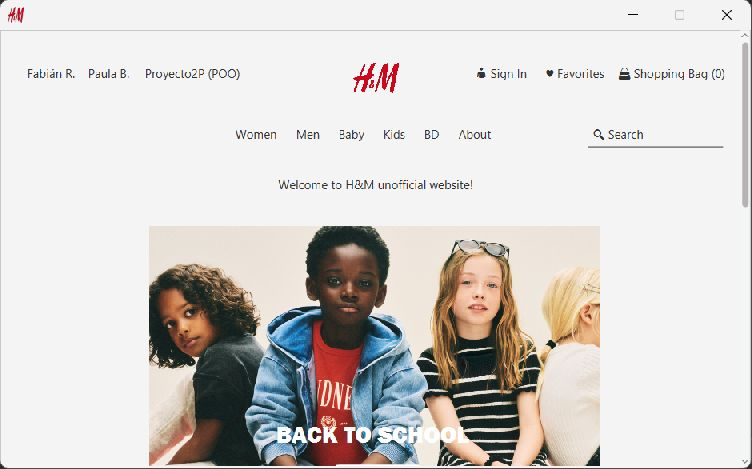

# H-M

H-M es una tienda de ropa de demostración para usar en tu computadora. Puedes recorrer prendas, elegir tallas, añadir productos al carrito y crear pedidos. Incluye una cuenta y una zona de administración para probar esos recorridos.

Todo el contenido de ejemplo es ficticio. No uses información personal ni contraseñas reales.

## Capturas de pantalla

### Inicio de la tienda

## Qué puedes probar

- Explorar prendas y sus tallas.
- Añadir distintas tallas de una prenda al carrito.
- Revisar el carrito y completar un pedido.
- Crear y administrar una cuenta de demostración.
- Consultar la zona de administración con una cuenta autorizada.

## Ejecutar en Windows

### Lo que necesitas

- Java 23 o posterior (probado con Java 25).
- Maven 3.9 o posterior.
- PostgreSQL 18.

### 1. Crear la base de datos

Abre PowerShell en la carpeta de H-M. Si psql no está disponible como comando, agrega la carpeta bin de PostgreSQL al PATH o usa la ruta completa a psql.exe.

    psql -U postgres -d postgres -c 'CREATE DATABASE "hm-db";'

Cuando psql lo solicite, escribe la contraseña local de tu instalación de PostgreSQL.

### 2. Preparar las tablas y los datos de ejemplo

Ejecuta estos comandos en la carpeta del proyecto, en este orden:

    psql -U postgres -d hm-db -v ON_ERROR_STOP=1 -f database/postgresql/schema.sql
    psql -U postgres -d hm-db -v ON_ERROR_STOP=1 -f database/postgresql/seed.sql
    psql -U postgres -d hm-db -v ON_ERROR_STOP=1 -f database/postgresql/sync-identities.sql
    psql -U postgres -d hm-db -v ON_ERROR_STOP=1 -f database/postgresql/migrations/001_order_details.sql

### 3. Completar la conexión local

Crea tu archivo local a partir de la plantilla y ábrelo para completar la conexión:

    Copy-Item .env.example .env
    notepad .env

En .env, escribe el nombre del servidor, puerto, base de datos, usuario y contraseña de tu PostgreSQL. Usa localhost, el puerto 5432 y el nombre hm-db si instalaste PostgreSQL con la configuración habitual. El usuario y la contraseña deben corresponder a tu instalación.

El archivo .env se queda en tu computadora y Git lo ignora. No lo compartas.

### 4. Abrir H-M

    mvn javafx:run

La primera ejecución puede tardar mientras Maven prepara los componentes necesarios. Para cerrar la tienda, cierra su ventana.

## Comprobar el proyecto

Para compilar y ejecutar las pruebas:

    mvn -B -ntp test
    mvn -B -ntp package

También puedes ejecutar la comprobación completa contra una base temporal:

    .\scripts\test-postgresql.ps1

Esa comprobación crea una base de prueba descartable dentro de target; no utiliza la base hm-db de tu archivo .env.

## Licencia

El código del proyecto se distribuye bajo la licencia [MIT](LICENSE). Los nombres y logotipos de otras marcas que aparezcan en la demostración pertenecen a sus titulares; el proyecto no está afiliado con esas marcas.

Para informar un problema de seguridad, consulta [SECURITY.md](SECURITY.md).
